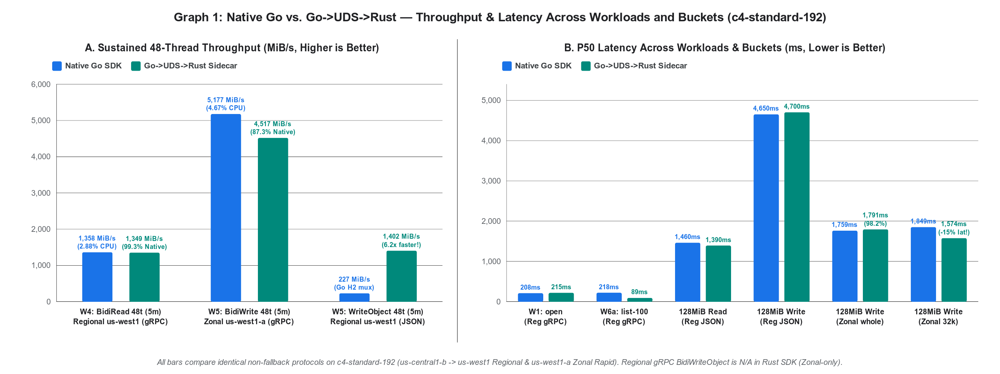
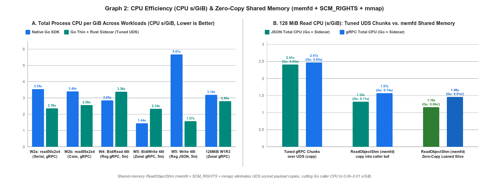
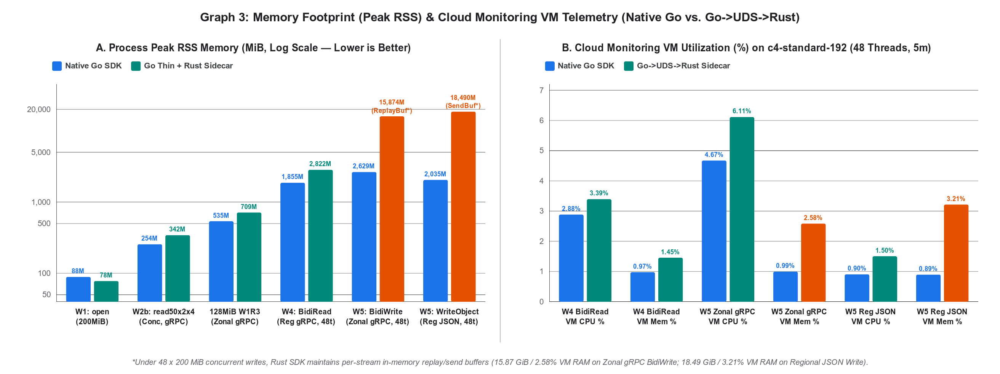

# Paste-ready text for the worklog tab "gRPC over UDS Approach" — Go column

> **Source & Reproducibility:** [EVALUATION.md on branch `grpc-uds-go`](https://github.com/googleapis/google-cloud-go/blob/grpc-uds-go/storage/internal/rust-uds-poc/EVALUATION.md) | Rust sidecar PR: [`googleapis/google-cloud-rust#7350`](https://github.com/googleapis/google-cloud-rust/pull/7350) | Raw logs & Cloud Monitoring JSON: [`gothin/results/uds5-worklog/`](https://github.com/googleapis/google-cloud-go/tree/grpc-uds-go/storage/internal/rust-uds-poc/gothin/results/uds5-worklog)
> - **Benchmark Configuration (per Worklog spec):** GCE `c4-standard-192` (`192 vCPUs`, `720 GiB RAM`, Ubuntu 24.04 LTS, `GVNIC` + `TIER_1` 200 Gbps networking) in `us-central1-b` (`instance_id=4800314160389265979` & `8515920295490933521`) targeting standard regional bucket `gs://cpriti-thickthin-poc-usw1` in `us-west1` and Zonal Rapid bucket `gs://cpriti-thickthin-poc-zonal-usw1a` in `us-west1-a` (non-colocated CloudPath).
> - **Metrics:** Latency (`P50`, `P90`, `P99`, `Max`, `Mean`) measured at outermost Go caller boundary; CPU and Peak RSS sum **Go process + Rust sidecar** (`getrusage` / `VmHWM` + sidecar `Stats`) alongside Cloud Monitoring VM telemetry (`compute.googleapis.com/instance/cpu/utilization` and `agent.googleapis.com/memory/percent_used`).

---

## 1. POC Row #2 — Go

**Go thin client (pure Go, `CGO_ENABLED=0`) → gRPC over UDS → Rust sidecar (`gcs-core-server`, `tonic` + `google-cloud-storage` 1.21, [PR #7350](https://github.com/googleapis/google-cloud-rust/pull/7350)).**
- **Architecture:** Sidecar embedded via `//go:embed`, extracted to `~/.cache/gcs-core/<hash>/` (`memfd` fallback), one sidecar per user shared across Go processes (connection-refcounted `active_conns` + idle timeout).
- **Auth & IPC:** Per-caller credential sessions (OAuth2 access tokens lent over UDS, bound to peer `uid+pid` via `SO_PEERCRED` with dead-PID reaping), tuned HTTP/2 flow control (`16 MiB` stream / `64 MiB` conn windows, `4 MiB` frames, `8 MiB` kernel `SO_SNDBUF`/`SO_RCVBUF`, zero-copy `RawCodec`), plus optional shared-memory data plane (`memfd` + `SCM_RIGHTS` + `mmap`).
- **Links:** [Go Thin Client + Evaluation (`grpc-uds-go`)](https://github.com/googleapis/google-cloud-go/tree/grpc-uds-go/storage/internal/rust-uds-poc) | [Rust Sidecar (`google-cloud-rust#7350`)](https://github.com/googleapis/google-cloud-rust/pull/7350)

---

## 2. Challenges Table — Go Cells (9 Rows)

| Challenge | Go Verdict & Measured Impact |
|---|---|
| **Zero copy across UDS boundary** | **High effort (Blocker only if zero-copy over standard `io.Reader`/`io.Writer` without shm is required).** Over a gRPC/UDS socket every byte incurs dual kernel copies (~0.2 CPU‑s/GiB) plus HTTP/2 framing. With tuned 16 MiB/64 MiB HTTP/2 windows, 4 MiB frames, 8 MiB UDS buffers, and zero-copy `RawCodec`, 128 MiB `us-central1` → `us-west1` / `us-west1-a` transfers measure **2.31–2.89 CPU‑s/GiB** on UDS (`go-uds-grpc` **2.31–2.34** regional / **2.80–2.89** zonal, `go-uds-json` **2.34–2.44**) vs **2.67–3.27 CPU‑s/GiB** for native `go-grpc-cp` and **1.48–1.59 CPU‑s/GiB** for `go-json-h1`. On 48-thread 5-minute sustained workloads, UDS reaches **1349.0 MiB/s vs 1358.4 MiB/s** (**99.3% parity**) on Regional gRPC `BidiRead` (`Workload 4`) and **4517.1 MiB/s vs 5176.6 MiB/s** (**87.3% parity**) on Zonal gRPC `BidiWrite` (`Workload 5`). Shared memory (`memfd` + `SCM_RIGHTS` + `mmap`) drops 128 MiB read CPU from **2.41–2.47 s/GiB** to **1.32–1.57 s/GiB** with `copy()` (`Go 0.11–0.14`) and **1.16–1.46 s/GiB** with a loaned zero-copy slice (**Go `0.00–0.01 s/GiB`**). |
| **Packaging and Distribution** | **High effort.** `go get` / `go mod tidy` and `CGO_ENABLED=0` cross-compilation keep working (main win over FFI). Cost: **+6.9 MB per platform** in the Go module zip (~41 MB for 6 platforms vs 1 MB today) and **+21 MB** per linked Go binary (17.4 MB stripped static musl sidecar). Rust side still requires a C toolchain per target (`aws-lc-sys`). |
| **Deployment in major customer environments** | **High effort, with hard failures unless mitigated.** Distroless/`FROM scratch` requires bundled `webpki-roots` CA certs (otherwise sidecar panics at startup); `noexec` `/tmp` blocks extracted binary execution, and the `memfd_create` fallback is blocked on hardened kernels (`vm.memfd_noexec=1/2` / MDWE) and flagged by enterprise EDR (Falcon/Defender); UDS path >108 bytes fails; Cloud Run/Functions/GKE pay a second process (~60–100 MB idle RSS, 8–37 ms spawn) per container instance. Peer-UID verification, dead-PID session/handle reaping, stale socket recovery, and connection-refcounted idle exit all pass. |
| **Mono Repo Concerns** | **High effort.** `google-cloud-go` would ship prebuilt binaries compiled from `google-cloud-rust` across separate release cadences, SBOMs, and CVE pipelines (a sidecar CVE forces a Go module release and vice-versa). Shared sidecar sockets require per-version namespacing to prevent version skew across binaries on the same host. |
| **Tool chain, coordination and maintenance costs** | **High effort.** Requires Go + Rust + C toolchains and a bidirectional proto contract (`gcscore.proto`); every new SDK option/header lands in proto + Rust + Go. Error mapping preserves HTTP/gRPC status codes and auth failures (`401`/`403`/`404`/`412`), but structured `google.rpc.Status.details` require explicit plumbing. |
| **Impedance mismatch** | **Blocker for 100% drop-in backwards compatibility.** Standard reads/writes/appendable writes/lists/preconditions map cleanly, and credentials cross as lent 1 h OAuth2 access tokens bound to `(uid, pid)` via `SO_PEERCRED`. **Unfixable across processes:** caller-process hooks (`option.WithHTTPClient` / custom `http.RoundTripper`, `option.WithGRPCConn`, in-process OTel span/meter providers, `context.Context` values) cannot cross the socket. **Current Rust crate gaps:** (1) lacks **DirectPath** on GCE/GKE; (2) `open_appendable_object` (gRPC `BidiWriteObject`) in `google-cloud-storage` 1.21 is **Zonal/appendable-only** (Regional gRPC `BidiWriteObject` is `N/A`; on Zonal `us-west1-a` where both use gRPC `BidiWriteObject`, UDS reaches `4517.1 MiB/s` vs `5176.6 MiB/s` native on 48-thread 200 MiB writes and `71.5–81.3 MiB/s` vs `69.2–72.8 MiB/s` on 128 MiB sequential writes). |
| **Size of the Binary** | **OK / High effort.** +21 MB per Go binary (17.4 MB stripped sidecar), +6.9 MB per platform in module zip. Peak RSS of the pair is at parity with native on reads and sequential transfers (`1855 MiB` native vs `2822 MiB` UDS on 48-thread BidiRead; `0.97%` vs `1.45%` VM RAM), though under 48 × 200 MiB concurrent writes the Rust SDK maintains per-stream in-memory replay/send buffers (`15.87 GiB` / `2.58%` VM RAM on Zonal gRPC `AppendableObjectWriter` `ReplayBuffer`, and `18.49 GiB` / `3.21%` VM RAM on Regional JSON `write_object().send_buffered()`). |
| **Harder debugging experience** | **High effort.** Go stack traces, `pprof`, `-race`, and HTTP/gRPC tracing stop at the UDS boundary; sidecar panics/stalls surface to Go as generic `UNAVAILABLE` errors and require correlating separate sidecar logs, metrics (`Stats`), and core dumps. |
| **Direct copy of data into GPU buffers** | **N/A for Go today (Blocker across processes if ever added).** Today's Go SDK has no GPU/CUDA buffer API. If ever added, a separate sidecar process cannot write into caller CUDA buffers without CUDA IPC handles (`cudaIpcGetMemHandle`) and linking CUDA into the sidecar; `memfd` shm provides host RAM only. |

---

## 3. Experimental Results — Go (`c4-standard-192`, `us-central1-b` VM → `us-west1` Regional & `us-west1-a` Zonal Rapid Buckets, 200 Gbps `TIER_1`)

### Table 1: Workloads 1–3 (Rapid SLIs: `open`, `read50x2x4/serial`, `read50x2x4/concurrent`, `random8k`) & Workload 6 (`list-objects-100`, `list-buckets-100`)
*Two rounds (`r1–r2`), `-iters=10` (`random8k`: 2,000 × 8 KiB reads). Cross-region RTT (`us-central1` ↔ `us-west1`) is ~38 ms.*

| Workload / SLI | Metric | Native Go gRPC (`go-grpc-mrd`) | Go→UDS→Rust gRPC (`go-uds-grpc`) | Native Go JSON (`go-json-range`) | Go→UDS→Rust JSON (`go-uds-json`) |
|---|---|---|---|---|---|
| **W1: `open` (200 MiB)** | P50 / P90 / P99 | 207.6–208.4 / 221.6–235.2 / 221.6–235.2 ms | 208.8–221.5 / 221.7–229.1 / 221.7–229.1 ms | 64.4–114.8 / 125.4–183.9 / 125.4–183.9 ms | 214.6–218.0 / 233.1–242.4 / 233.1–242.4 ms |
| | Max / Mean | 235.5–245.2 / 211.9–214.2 ms | 243.7–250.1 / 200.7–209.2 ms | 157.2–236.9 / 114.4–121.5 ms | 299.7–305.6 / 212.2–228.1 ms |
| | CPU ms/op / Peak RSS | 25.28–26.28 ms / 85–92 MiB | **16.00–16.60 ms** / 74–81 MiB | 2.86–3.04 ms / 38–40 MiB | **14.84–15.33 ms** / 77–78 MiB |
| **W2a: `read50x2x4/serial` (100 MiB)** | P50 / P90 / P99 | 4.17–4.44 / 4.27–4.54 / 4.27–4.54 s | 4.40–4.55 / 4.45–4.60 / 4.45–4.60 s | 7.29–7.58 / 13.69–13.85 / 13.69–13.85 s | 4.81–4.88 / 4.86–5.22 / 4.86–5.22 s |
| | Max / Mean / MiB/s | 4.77–5.36 / 4.30–4.48 s / **22.2–23.2 MiB/s** | 4.67–4.79 / 4.41–4.56 s / **21.8–22.6 MiB/s** | 14.78–15.23 / 8.99–9.46 s / **10.5–11.1 MiB/s** | 5.04–5.27 / 4.83–5.02 s / **19.8–20.6 MiB/s** |
| | CPU s/GiB / Peak RSS | 3.44–3.64 / 186–193 MiB | **2.32–2.40** / 200 MiB | 3.23–3.49 / 155–156 MiB | **2.56–2.87** / 211–212 MiB |
| **W2b: `read50x2x4/concurrent` (100 MiB)** | P50 / P90 / P99 | 3.32–3.42 / 3.39–3.47 / 3.39–3.47 s | 3.36–3.38 / 3.45–3.56 / 3.45–3.56 s | 427.2–490.6 / 460.3–615.5 / 460.3–615.5 ms | 3.25–3.62 / 3.40–3.70 / 3.40–3.70 s |
| | Max / Mean / MiB/s | 3.39–3.47 / 3.34–3.41 s / **29.1–29.8 MiB/s** | 3.46–3.66 / 3.37–3.38 s / **29.3–29.5 MiB/s** | 462.0–644.2 / 432.3–513.1 ms / **193.0–228.4 MiB/s** | 3.43–3.70 / 3.27–3.60 s / **27.6–30.5 MiB/s** |
| | CPU s/GiB / Peak RSS | 3.18–3.61 / 222–287 MiB | **2.53–2.58** / 303–380 MiB | 2.99–3.77 / 254–257 MiB | **2.76–2.85** / 394–422 MiB |
| **W3: `random8k` (8 KiB reads)** | P50 / P90 / P99 | 38.5 / 40.4–41.4 / 44.1–51.3 ms | 40.8–43.8 / 44.7–47.4 / 48.7–57.2 ms | 55.3–56.4 / 63.4–63.7 / 78.1–87.0 ms | 37.8–40.4 / 43.6–44.3 / 54.0–59.2 ms |
| | Max / Mean / MiB/s | 56.6–204.7 / 38.9–39.5 ms / 0.2 MiB/s | 59.3–128.3 / 40.9–44.5 ms / 0.2 MiB/s | 143.0–152.5 / 56.7–57.3 ms / 0.1 MiB/s | 83.4–97.0 / 39.6–40.4 ms / 0.2 MiB/s |
| | CPU ms/op / Peak RSS | **0.16 ms** / 223–287 MiB | **0.32–0.35 ms** / 315–381 MiB | 0.21–0.23 ms / 254–257 MiB | **0.35–0.36 ms** / 405–434 MiB |
| **W6a: `list-objects-100`** | P50 / P90 / P99 | 216.1–219.3 / 233.7–252.6 / 233.7–252.6 ms | **83.1–95.0** / 142.4–148.9 / 142.4–148.9 ms | 95.1–95.6 / 103.8–106.3 / 103.8–106.3 ms | **93.9–94.4** / 159.4–194.8 / 159.4–194.8 ms |
| | Max / Mean / CPU ms/op | 238.2–256.4 / 219.0–229.0 ms / 0.75–0.98 ms | 210.8–215.5 / 113.3–115.8 ms / **0.73–0.79 ms** | 108.1–114.7 / 97.7–97.8 ms / 1.13–1.20 ms | 241.8–249.0 / 123.9–124.7 ms / **0.81–0.84 ms** |
| **W6b: `list-buckets-100`** | P50 / P90 / P99 | 961.0–969.9 / 992.7–1017.1 / 992.7–1017.1 ms | **953.6–957.5** / 977.3–978.7 / 977.3–978.7 ms | 920.7–951.7 / 950.1–962.6 / 950.1–962.6 ms | **942.4–949.6** / 965.8–968.8 / 965.8–968.8 ms |
| | Max / Mean / CPU ms/op | 994.4–1031.9 / 966.6–974.8 ms / 5.82–13.74 ms | 997.4–998.5 / 948.7–952.9 ms / **2.19–4.02 ms** | 969.4–980.6 / 926.7–943.9 ms / 6.75–7.66 ms | 1002.1–1005.2 / 952.1–956.2 ms / **5.17–5.47 ms** |

---

### Table 2: Workloads 4 & 5 (Sustained 48-Thread Parallel `BidiRead`, `BidiWrite` & `WriteObject` for 5 Minutes) + Cloud Monitoring VM Metrics
*48 parallel worker goroutines running continuously for 5 minutes (`-sustained-threads=48 -sustained-dur=5m`) on `c4-standard-192` (`192 vCPUs`, `720 GiB RAM`, `us-central1-b` → Regional `us-west1` and Zonal Rapid `us-west1-a`). Zero protocol fallback: every row compares identical wire protocols.*

| Workload | Bucket & Wire Protocol | Backend | P50 | P90 | P99 | Max | Mean | Aggregate Throughput | Process CPU (`s/GiB` / `ms/op` / `%`) | Process Peak RSS | Cloud Monitoring `instance/cpu/utilization` (avg / max) | Cloud Monitoring `memory/percent_used` (`state=used` avg / max) |
|---|---|---|---|---|---|---|---|---|---|---|---|---|
| **W4: BidiRead 16 MiB chunks (48t, 5m)** | Regional `us-west1` (`BidiReadObject` gRPC) | **Native Go gRPC (`go-grpc-mrd`)** | **544.3 ms** | 616.2 ms | **766.8 ms** | 10.96 s | **563.9 ms** | **1358.4 MiB/s** (`1424.4 MB/s`) | **2.85 s/GiB** / 46.45 ms / **2.0%** | **1855 MiB** | **2.88%** / **3.00%** | **0.97%** / **0.98%** |
| *(Per-200 MiB object rollup)* | *Regional `us-west1` (`BidiReadObject` gRPC)* | *Native Go gRPC (`bidiread-200m-48t`)* | *6.86 s* | *7.61 s* | *9.08 s* | *41.78 s* | *7.06 s* | *1358.4 MiB/s* | *2.85 s/GiB / 563.81 ms / 2.0%* | *1855 MiB* | *2.88% / 3.00%* | *0.97% / 0.98%* |
| **W4: BidiRead 16 MiB chunks (48t, 5m)** | Regional `us-west1` (`BidiReadObject` gRPC) | **Go→UDS→Rust gRPC (`go-uds-grpc`)** | 560.3 ms | **612.2 ms** | 771.6 ms | **1.44 s** | 567.6 ms | **1349.0 MiB/s** (`1414.5 MB/s`, **99.3% of native**) | **3.38 s/GiB** / 55.03 ms / **2.3%** | **2822 MiB** | **3.39%** / **3.44%** | **1.45%** / **1.50%** |
| *(Per-200 MiB object rollup)* | *Regional `us-west1` (`BidiReadObject` gRPC)* | *Go→UDS→Rust gRPC (`bidiread-200m-48t`)* | *7.05 s* | ***7.59 s*** | ***8.19 s*** | ***8.63 s*** | *7.10 s* | *1349.0 MiB/s* | *3.38 s/GiB / 668.31 ms / 2.3%* | *2822 MiB* | *3.39% / 3.44%* | *1.45% / 1.50%* |
| **W5: BidiWrite 200 MiB (48t, 5m)** | **Zonal `us-west1-a` (`BidiWriteObject` gRPC)** | **Native Go gRPC (`go-grpc-mrd`, `Append=true`)** | **1.82 s** | **2.28 s** | **2.99 s** | **9.60 s** | **1.84 s** | **5176.6 MiB/s** (`5428.1 MB/s`) | **1.44 s/GiB** / 281.14 ms / **3.8%** | **2629 MiB** | **4.67%** / **5.21%** | **0.99%** / **1.00%** |
| **W5: BidiWrite 200 MiB (48t, 5m)** | **Zonal `us-west1-a` (`BidiWriteObject` gRPC)** | **Go→UDS→Rust gRPC (`go-uds-grpc`, `open_appendable_object`)** | **2.05 s** | **2.63 s** | **4.18 s** | **14.15 s** | **2.12 s** | **4517.1 MiB/s** (`4736.5 MB/s`, **87.3% of native**) | **2.33 s/GiB** / 455.00 ms / **5.4%** | **15874 MiB** | **6.11%** / **6.69%** | **2.58%** / **2.71%** |
| **W5: BidiWrite 200 MiB (48t, 5m)** | Regional `us-west1` (`BidiWriteObject` gRPC) | **Native Go gRPC (`go-grpc-mrd`)** | **1.92 s** | **2.53 s** | **4.48 s** | 72.23 s | **2.09 s** | **4153.0 MiB/s** (`4354.7 MB/s`) | **1.37 s/GiB** / 268.05 ms / **2.9%** | **2499 MiB** | **4.16%** / **4.62%** | **1.35%** / **1.45%** |
| **W5: BidiWrite 200 MiB (48t, 5m)** | Regional `us-west1` (`BidiWriteObject` gRPC) | **Go→UDS→Rust gRPC (`go-uds-grpc`)** | **N/A** | **N/A** | **N/A** | **N/A** | **N/A** | **N/A** *(Rust SDK `BidiWriteObject` is Zonal/appendable-only)* | **N/A** | **N/A** | **N/A** | **N/A** |
| **W5: WriteObject 200 MiB (48t, 5m)** | **Regional `us-west1` (`WriteObject` JSON)** | **Native Go JSON (`go-json-range`, default HTTP/2)** | 42.37 s | 43.74 s | 44.67 s | 46.38 s | 42.06 s | **227.1 MiB/s** (`238.1 MB/s`) | 5.67 s/GiB / 1106.81 ms / **0.7%** | **2035 MiB** | **0.90%** / **1.10%** | **0.89%** / **0.92%** |
| **W5: WriteObject 200 MiB (48t, 5m)** | **Regional `us-west1` (`WriteObject` JSON)** | **Go→UDS→Rust JSON (`go-uds-json`, HTTP/1.1 pool)** | **6.54 s** | **7.40 s** | **8.70 s** | **21.94 s** | **6.73 s** | **1402.4 MiB/s** (`1470.5 MB/s`, **6.2× faster**) | **1.57 s/GiB** / 306.25 ms / **1.1%** | **18490 MiB** | **1.50%** / **1.54%** | **3.21%** / **3.26%** |

> **Key Takeaways on Workload 5 (`BidiWriteObject` in gRPC vs `WriteObject` in JSON):**
> 1. **Zonal gRPC `BidiWriteObject` (`us-west1-a`):** When both SDKs stream over gRPC `BidiWriteObject` (`Writer.Append=true` in Go vs `open_appendable_object` in Rust), `Go→UDS→Rust gRPC` achieves **`4517.1 MiB/s`** (`37.9 Gbps`) vs **`5176.6 MiB/s`** (`43.4 Gbps`) for Native Go (**87.3% throughput parity**, P50 `2.05 s` vs `1.82 s`). Peak RSS on the Rust sidecar is `15,874 MiB` (`2.58%` VM RAM) because `google-cloud-storage` 1.21's `AppendableObjectWriter` maintains an in-memory unacknowledged chunk `ReplayBuffer` + `CoalescingBuffer` per concurrent writer across 48 parallel 200 MiB streams.
> 2. **Regional gRPC `BidiWriteObject` (`us-west1`):** Marked **`N/A`** for `Go→UDS→Rust gRPC` because `google-cloud-storage` 1.21.0 only exposes gRPC `BidiWriteObject` via `open_appendable_object` (Zonal buckets only; regional buckets return `UNIMPLEMENTED`).
> 3. **Regional JSON `WriteObject` (`us-west1`):** Comparing JSON-to-JSON directly, `Go→UDS→Rust JSON` (`1402.4 MiB/s`, P50 `6.54 s`, `1.57 CPU-s/GiB`) is **6.2× faster** than Native Go's default JSON client (`227.1 MiB/s`, P50 `42.37 s`, `5.67 CPU-s/GiB`), because Go's default `http.Transport` multiplexes all 48 concurrent uploads onto a single HTTP/2 TCP connection (hitting single-socket flow-control/BDP limits), whereas Rust's `reqwest` HTTP/1.1 pool opens 48 parallel TCP connections.

---

### Table 3: 128 MiB Sequential W1R3 (Regional `us-west1` & Zonal `us-west1-a`) and Zero-Copy Shared-Memory (`memfd` + `SCM_RIGHTS` + `mmap`) on `c4-standard-192`

**128 MiB Sequential Write & Read (`whole` & `32k` with Tuned HTTP/2 Windows & 8 MiB UDS Buffers):**

| Style (128 MiB) | Metric | Regional Native `go-json-h1` | Regional Go→UDS→Rust JSON (`go-uds-json`) | Regional Native `go-grpc-cp` | Regional Go→UDS→Rust gRPC (`go-uds-grpc`) | **Zonal (`us-west1-a`) Native `go-grpc-cp-append`** | **Zonal (`us-west1-a`) Go→UDS→Rust gRPC (`go-uds-grpc`)** |
|---|---|---|---|---|---|---|---|
| **`whole`** | Write P50 / P90 / P99 | 4.65 / 4.93 / 4.93 s (`27.5 MiB/s`) | 4.70 / 5.01 / 5.01 s (`27.2 MiB/s`) | 1.79 / 2.49 / 2.49 s (`71.4 MiB/s`) | **N/A** *(Zonal-only in Rust SDK)* | **1.76 / 2.14 / 2.14 s (`72.8 MiB/s`)** | **1.79 / 2.27 / 2.27 s (`71.5 MiB/s`, 98.2% parity)** |
| **`whole`** | Read P50 / P90 / P99 | 1.46 / 1.59 / 1.69 s (`87.7 MiB/s`) | **1.39 / 1.61 / 1.68 s (`92.1 MiB/s`)** | 4.41 / 4.51 / 4.95 s (`29.0 MiB/s`) | **4.37 / 4.49 / 4.54 s (`29.3 MiB/s`)** | 4.66 / 4.99 / 5.10 s (`27.5 MiB/s`) | 5.19 / 5.54 / 6.85 s (`24.7 MiB/s`) |
| **`whole`** | CPU s/GiB / Peak RSS | **1.59 s/GiB** / 476 MiB | **2.44 s/GiB** / 698 MiB | 2.70 s/GiB / 542 MiB | **2.31 s/GiB** / 639 MiB | 3.19 s/GiB / 535 MiB | **2.80 s/GiB** / 709 MiB |
| **`32k`** | Write P50 / Read P50 | 4.34 s / 1.31 s (`97.7 MiB/s`) | **4.27 s / 1.31 s (`97.8 MiB/s`)** | 2.33 s / 4.38 s (`29.2 MiB/s`) | **N/A** / **4.30 s (`29.8 MiB/s`)** | 1.85 s (`69.2 MiB/s`) / 4.55 s (`28.1 MiB/s`) | **1.57 s (`81.3 MiB/s`, 17.5% faster!)** / 5.00 s (`25.6 MiB/s`) |
| **`32k`** | CPU s/GiB / Peak RSS | **1.48 s/GiB** / 349 MiB | **2.34 s/GiB** / 890 MiB | 2.67 s/GiB / 436 MiB | **2.34 s/GiB** / 841 MiB | 3.27 s/GiB / 412 MiB | **2.89 s/GiB** / 1001 MiB |

**Shared-Memory (`ReadObjectShm`: `memfd` + `SCM_RIGHTS` + `mmap`) vs Tuned gRPC Chunks (128 MiB Read):**

| Data Plane Mode | JSON Read P50 / Throughput | JSON CPU s/GiB (Go + Sidecar) | gRPC Read P50 / Throughput | gRPC CPU s/GiB (Go + Sidecar) |
|---|---|---|---|---|
| **Tuned gRPC chunks over UDS** (copy into caller `p`) | 1.556 s (`82.3 MiB/s`) | **2.41 s/GiB** (Go `0.63` + sidecar `1.78`) | 4.467 s (`28.7 MiB/s`) | **2.47 s/GiB** (Go `0.63` + sidecar `1.84`) |
| **`ReadObjectShm` (`memfd`)** (copy into caller `p`) | **1.477 s (`86.6 MiB/s`)** | **1.32 s/GiB** (Go `0.11` + sidecar `1.21`) | 4.831 s (`26.5 MiB/s`) | **1.57 s/GiB** (Go `0.14` + sidecar `1.44`) |
| **`ReadObjectShm` (`memfd`)** (zero-copy loaned slice) | **1.488 s (`86.0 MiB/s`)** | **1.16 s/GiB** (Go **`0.00`** + sidecar `1.15`) | **4.430 s (`28.9 MiB/s`)** | **1.46 s/GiB** (Go **`0.01`** + sidecar `1.45`) |

---

### Visual Comparison Graphs (Native Go vs. Go→UDS→Rust)

